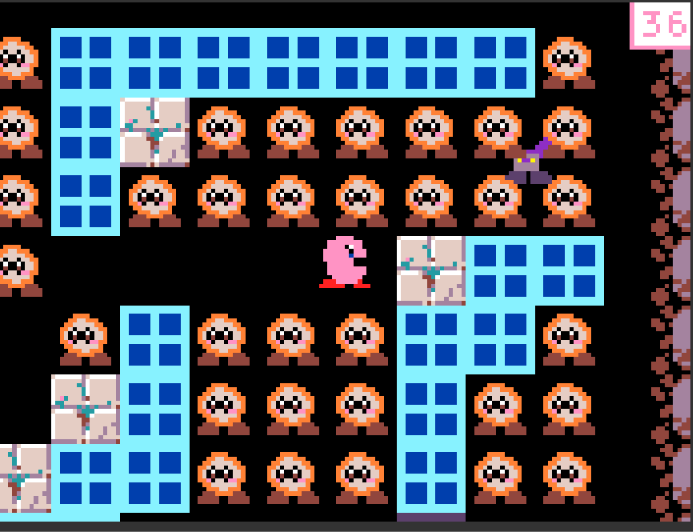
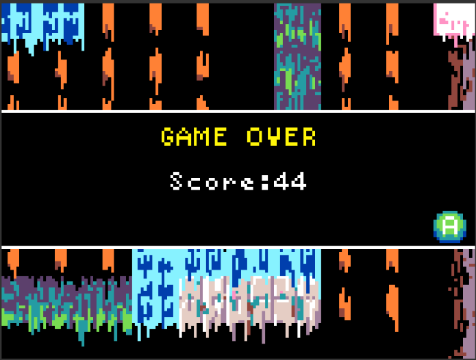
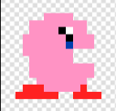
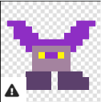
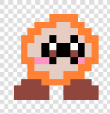

# 🟡 팩맨 (Pac-Man)

Direct Link: [https://arcade.makecode.com/S00611-62778-62696-33937](https://arcade.makecode.com/S00611-62778-62696-33937)

> 🚀 **Click the button above to play my Pac-Man game directly in your web browser!**

A classic maze-chase arcade game (**팩맨 / Pac-Man**) recreated with **Microsoft MakeCode Arcade**! 🕹️✨  
Created by a 2nd-grade elementary school developer (me!!), this project features a custom pixel-art maze, real-time score tracking, ghost/enemy avoidance, and a classic Game Over system.

## 🖼️ Gameplay & Game Over Screenshot

---

## 🎨 Game Assets & Pixel Art

Every maze wall, character, and effect was custom-designed in the MakeCode Arcade Sprite & Tilemap Editor:

| Asset | Name | Role & Description |
| :---: | :---: | :--- |
|  | **Pac-Man** | **Player Character:** Controlled by the player to navigate through the dark maze and collect points. |
|  | **Maze Ghost** | **Enemy AI:** Roams the maze corridors to chase or block Pac-Man. |
|  | **Orange Maze Wall** | **Tilemap Barrier:** Classic retro-style orange maze walls set against a pitch-black arcade background. |
|  | **Score Pellet** | **Collectible Item:** Increases the player's score (`Score: 44+`) when eaten inside the maze. |

---

## 🧠 Key Programming Features & Game Logic

* **Maze Navigation & Wall Collisions:** Designed a custom tilemap with orange walls so characters move smoothly through corridors without passing through barriers.
* **Score Tracking System:** Implemented real-time score counting that updates dynamically as the player collects items in the maze.
* **Game Over & Melt Screen Effect:** Triggered a retro screen-melt visual effect and a `GAME OVER` banner displaying the final score (`Score: 44`) when the player collides with an enemy, allowing instant replay with the **A** button.
* **Structured Logic (`for` Loops & Functions):** Used loops and custom functions to spawn items across the maze and manage game states cleanly.

---

## 🕹️ Controls (Keyboard)

| Key | Action |
| :--- | :--- |
| **⬆️ / ⬇️ / ⬅️ / ➡️ (Arrow Keys)** | Move Pac-Man up, down, left, and right through the maze |
| **A (or Spacebar / Z)** | Restart the game on the Game Over screen |

---

## 💻 Development Environment
* **Engine:** [Microsoft MakeCode Arcade](https://makecode.com)
* **Core Concepts Used:** Tilemap Maze Design, Score Variables, Overlap & Collision Events, Visual Screen Effects (`melt`), `for` Loops & Functions
* **Developer:** 2nd Grade Elementary School Student (Me!!) 👦👧
